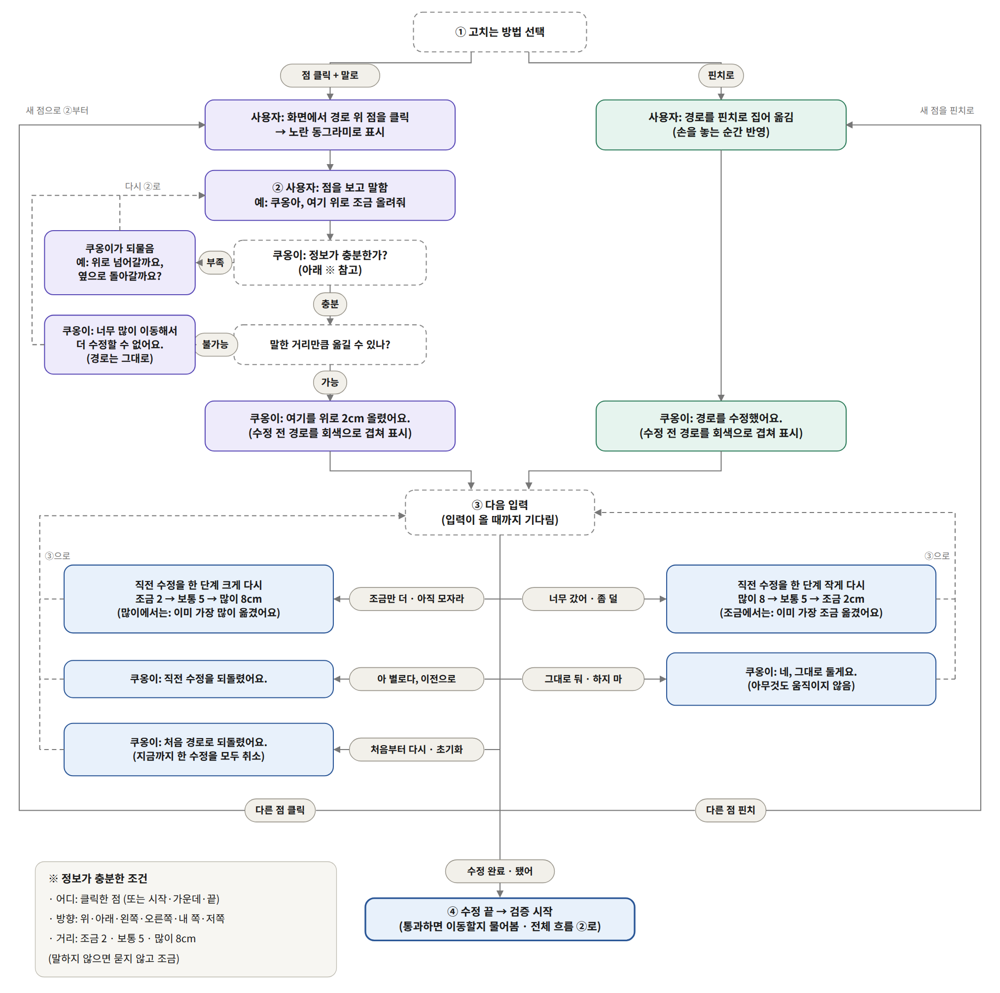

# KHU AI Challenge 2026

말과 손짓으로 로봇팔 경로를 고치는 인터페이스 (ChatKHU 활용)

## 작업 규칙

- main 브랜치에는 직접 올리지 않습니다.
- 각자 자기 브랜치에서 작업하고, 합칠 때는 Pull Request를 올립니다.
- branch 이름은 무엇을 만들었는지 알 수 있는 이름으로 합니다.
- API 키, 개인정보는 절대 올리지 않습니다.

---

# 이 브랜치: `voice-mujoco-path-edit`

MuJoCo 시뮬레이터에 로봇팔의 경로가 그려지고, 사용자는 **말과 손으로** 경로를 고칩니다.

- **말:** "쿠옹아, 여기 위로 조금 올려줘"처럼 말하면 **ChatKHU(경희대 생성형 AI, Gemini Live)** 가 알아듣고 시뮬레이터에 명령을 보냅니다. AI 이름은 **쿠옹이**, 부르는 말은 **"쿠옹아"** 입니다.
- **손:** 카메라 앞에서 **검지를 펴서 가리키면** 경로에서 가장 가까운 점이 골라지고(그다음 말로 고침), **검지와 엄지로 집으면(핀치)** 그 점을 잡아 **손이 3D로 움직인 만큼 1:1로** 옮깁니다. 3D 움직임은 Astra 깊이 카메라로 잽니다.
- **카메라 화면:** Astra 카메라를 보정하면 실제 카메라 화면 위에 원점, x·y·z 축, 시작점 A, 목표점 B, 경로가 제자리에 겹쳐 그려집니다.
- 다 고치고 "수정 완료"라고 하면 시뮬레이터가 경로를 12가지로 검사하고, 통과하면 쿠옹이가 **"검증을 통과했어요. 이동할까요, 더 고칠까요?"** 라고 묻습니다. "이동해"라고 답해야 움직입니다.
- 조금 · 보통 · 많이는 항상 **2 · 5 · 8 cm** 입니다.
- 실제 로봇은 움직이지 않습니다. 모든 동작은 시뮬레이터 안에서만 일어납니다.

## 한눈에 보기: 대화 흐름

처음 보는 분은 아래 두 그림부터 보면 전체가 이해됩니다.

### 1. 전체 흐름

가는 길을 고쳐서 목표까지 가고(1단계), 도착하면 돌아오는 길을 고칠지 그대로 거꾸로 돌아올지 고릅니다(2단계). 고친 길은 검사를 통과해도 바로 움직이지 않고, 이동할지 더 고칠지 한 번 묻습니다. 움직이는 중에는 언제든 "멈춰"라고 하면 바로 멈추고, 계속 갈지·돌아갈지를 고를 수 있습니다. 멈춘 뒤 돌아가서 출발했던 자리에 오면 다시 묻습니다.


### 2. 경로 수정 흐름 (위 그림의 ①)

점을 클릭(또는 검지로 가리킨) 뒤 말로 고치거나, 핀치(또는 마우스 끌기)로 고칩니다. 고친 뒤에는 "조금만 더", "너무 갔어", "이전으로", "처음부터 다시" 같은 말로 이어서 고치거나 다른 점을 고르고, "수정 완료"라고 하면 검사로 넘어갑니다.



멈춘 뒤의 흐름만 따로 그린 그림도 있습니다: [docs/flow/flow3_stop.png](docs/flow/flow3_stop.png)

## 준비물

- **컴퓨터:** Ubuntu 24.04, Python 3.12 (이 버전에서 확인). 화면이 있는 데스크톱과 OpenGL이 되는 그래픽(NVIDIA 등).
- **마이크** (스피커는 선택). 키보드 입력(`--text`)으로도 전부 시험할 수 있습니다.
- **ChatKHU API 키** (`BAZE_API_KEY`)와 인터넷.
- **Orbbec Astra Pro 카메라** — 카메라 화면 연동, 손의 3D 이동에 필요합니다. 없으면 시뮬레이터 카메라 화면과 마우스(또는 노트북 웹캠 손 입력)로 쓸 수 있습니다.
- **A4 두 장, 펜, 테이프** — 카메라 보정용.

## 폴더 구성

- `voice/` — ChatKHU 음성 프로그램(쿠옹이). 마이크(또는 키보드) → ChatKHU Gemini Live → 시뮬레이터에 명령.
  - `prompts/system_v5.md` 지금 쓰는 AI 지시문, `tools.py` AI가 부르는 함수 14개, `sim_link.py` 시뮬레이터 연결, `config.yaml` 호출어·목소리·2·5·8 cm 설정
- `mujoco_sim/` — MuJoCo 시뮬레이터. 경로 생성, 클릭·끌기 수정, 손 입력(가리키기·핀치, 깊이로 3D 이동), 12항목 검사, 이동 승인, 실행, 멈춤·이어가기, 경로 저장, 카메라 화면 위 축·A·B·경로 그리기.
- `pac_vision/` — Astra 카메라 보정(카메라 → 로봇 바닥 좌표)과 깊이 읽기. 시뮬레이터가 이 코드를 그대로 불러 씁니다.
- `6dof_description/` — 6축 로봇팔 모델(URDF, 메시, MuJoCo 장면)과 그리퍼.
- `path 편집/` — 경로를 부드럽게 휘게 하는 편집 알고리즘. 시뮬레이터가 그대로 가져다 씁니다.
- `docs/flow/` — 위 흐름도 그림과 그 원본.

`mujoco_sim/`, `6dof_description/`, `path 편집/`, `pac_vision/` 은 팀 저장소 `26_project_manipulator`에서 가져와(앞의 셋은 `work/integration-all`, pac_vision은 `work/astra-calibration` 브랜치) 이 작업을 더한 것입니다. pac_vision에는 보정 화면 안내 문구와 "번호 키로 그 점만 다시 클릭" 기능을 더했습니다.

## 설치 (처음 한 번)

아래를 위에서부터 순서대로 실행합니다. `sudo`가 붙은 줄은 관리자 비밀번호를 묻습니다.

```bash
# 1) 시스템 패키지
sudo apt install -y git python3-venv python3-pip libportaudio2 fonts-noto-cjk x11-utils x11-xserver-utils libopenni2-dev

# 2) 이 브랜치 받기 (비공개 저장소라 GitHub 로그인이 필요합니다: gh auth login)
git clone -b voice-mujoco-path-edit https://github.com/oryise12/CHATKHU.git ~/CHATKHU
cd ~/CHATKHU/mujoco_sim

# 3) 시뮬레이터 가상환경 + 로봇 장면 만들기
python3 -m venv .venv
source scripts/env.sh                      # .venv 켜기 (ROS 경로가 있으면 빼 줌)
pip install -r requirements.lock
python -m pinch_sim.build_scene            # 로봇 모델에서 시뮬레이터 장면을 만든다

# 4) 손 입력 (MediaPipe). 꼭 이 두 줄 그대로: mediapipe를 그냥 설치하면 numpy 2가 깔려 시뮬레이터가 깨집니다
pip install --no-deps mediapipe==0.10.21
pip install -r requirements-hand.txt         # "mediapipe requires jaxlib / opencv-contrib-python" 두 줄은 정상 (일부러 뺀 것)

# 5) Astra 카메라용 (pac_vision + 깊이 읽기)
pip install -r requirements-astra.txt
python -m pytest -q                        # "126 passed"처럼 failed 없이 끝나면 정상 (약 2~4분)
deactivate

# 6) Astra 드라이버와 USB 권한 (카메라가 있을 때)
git clone https://github.com/orbbec/ros2_astra_camera.git ~/ros2_astra_camera     # 드라이버 파일만 씀 (빌드 안 함)
sudo bash -c 'echo SUBSYSTEM==\"usb\", ATTR{idVendor}==\"2bc5\", MODE:=\"0666\" > /etc/udev/rules.d/99-orbbec.rules'
sudo udevadm control --reload-rules && sudo udevadm trigger
#    그다음 카메라를 뽑았다가 다시 꽂습니다

# 7) 카메라 정합 계수 (컬러 ↔ 깊이 픽셀 맞춤)
cp ~/CHATKHU/pac_vision/config/pose_presets/astra_unit1.yaml ~/CHATKHU/pac_vision/config/pose.yaml
#    팀의 "카메라 실물 1"용 값입니다. 다른 Astra면 pac_vision/CALIBRATION_GUIDE.md의 "정합 쌍 재기"로 새로 잽니다.

# 8) 음성 가상환경
cd ~/CHATKHU
python3 -m venv .venv-voice
.venv-voice/bin/pip install -r voice/requirements.txt

# 9) ChatKHU API 키 (저장소에 절대 넣지 않습니다)
echo 'export BAZE_API_KEY=여기에_키' >> ~/.bashrc
source ~/.bashrc
```

카메라 연결 확인 (카메라를 꽂은 뒤):

```bash
cd ~/CHATKHU/pac_vision && source ../mujoco_sim/.venv/bin/activate
python scripts/check_setup.py              # 끝 줄이 [요약] ⚠️ 3개면 정상: ultralytics, lap(물체 인식용, 여기서는 안 씀)과
                                           # 'cam2base.yaml 없음'(보정 전). pose.yaml·OpenNI redist ⚠️가 있으면 설치 6·7단계 확인
for d in /dev/video*; do echo -n "$d : "; cat /sys/class/video4linux/$(basename $d)/name; done
#    "Astra Pro"가 붙은 번호 둘 중 작은 번호가 컬러 카메라입니다 (예: /dev/video2 → 2). 아래 --video에 씁니다
```

- 드라이버를 `~/ros2_astra_camera`가 아닌 곳에 받았다면 `pac_vision/config/local.yaml`을 만들어 경로를 적습니다. 형식은 `pac_vision/config/local.example.yaml`에 있고, 필요한 줄만 남깁니다:
  ```yaml
  camera:
    openni:
      redist: ~/내가/받은/ros2_astra_camera/astra_camera/openni2_redist/x64
  ```

## 카메라 보정 (카메라를 놓거나 옮길 때마다, 약 5분)

보정을 하면 "카메라 화면의 픽셀 ↔ 로봇 바닥 기준 좌표"를 서로 바꿀 수 있게 됩니다. 그래야 화면에 축과 경로를 제자리에 그리고, 손가락 위치를 로봇 좌표로 바꿀 수 있습니다.

**1. 종이 준비.** A4 두 장을 긴 변끼리 틈 없이 이어 붙여(뒤에서 테이프) 29.7 × 42.0 cm 직사각형을 만듭니다.

- 한 장(대각선 종이)에 대각선 두 개를 긋습니다. 두 대각선이 만나는 점이 **원점 (0, 0, 0)** 입니다.
- 같은 종이에 원점을 지나 긴 변과 나란히 **X 화살표**를 그립니다. 화살표 쪽이 +X(로봇의 앞)입니다.
- 다른 한 장(맞댄 종이)은 대각선 종이의 왼쪽(+Y)에 붙어 있어야 합니다.
- 바깥 꼭짓점 네 개에 번호를 적습니다. 위에서 볼 때 반시계 방향으로, 대각선 종이의 뒤-오른쪽이 1, 앞-오른쪽이 2, 맞댄 종이의 앞-왼쪽이 3, 뒤-왼쪽이 4입니다.
- 종이를 책상 위 로봇 자리에 평평하게 붙이고, 카메라를 고정합니다. 카메라와 종이 사이는 0.6 m 이상 떨어져야 깊이를 잴 수 있습니다.

**2. 보정 실행.** 시뮬레이터가 켜져 있으면 먼저 닫습니다(카메라는 한 프로그램만 열 수 있습니다).

```bash
cd ~/CHATKHU/pac_vision && source ../mujoco_sim/.venv/bin/activate
python scripts/calibrate.py
```

- **배치 점검 화면:** ✓가 나오는지 봅니다. ⚠가 나오면 그 아래 ▶ 안내대로 카메라를 옮깁니다. 괜찮으면 Enter.
- **클릭:** 원점(대각선 교차점) → 꼭짓점 1 → 2 → 3 → 4 순서로 클릭합니다. 확대경이 따라다닙니다. 잘못 눌렀으면 u(하나 되돌리기), r(처음부터).
- **결과 화면:** 검사 5가지가 ✓ 통과 / ⚠ 주의 / × 실패로 나오고, 안 된 항목 아래에 ▶ 고치는 법이 나옵니다.
  - 어긋난 점이 있으면 **그 번호 키(0~4, 0은 원점)** 를 눌러 그 점만 다시 클릭합니다.
  - 다 통과하면 **s** 로 저장합니다. `pac_vision/config/cam2base.yaml`이 만들어집니다.
- 보정이 끝나면 종이 위 원점에 로봇을 두고(앞면을 X 화살표 쪽으로) 카메라는 더 움직이지 않습니다. 로봇을 다른 자리에 둘 때는 아래 `--robot-pose`로 알려 줍니다.

## 좌표, 로봇 위치, A와 B

모든 좌표는 **보정 좌표계** 기준이고 단위는 **m** 입니다.

- 원점 = A4 대각선 교차점, 책상면 높이 = 0
- +X = 앞(종이의 X 화살표 쪽), +Y = 왼쪽, +Z = 위

시뮬레이터를 켤 때 세 가지를 줄 수 있습니다.

- `--robot-pose X,Y,각도` — 로봇 바닥 중심이 놓인 자리와 로봇 앞이 향한 방향(+X에서 반시계로 몇 도). 원점에 +X를 보고 서 있으면 생략합니다.
- `--start X,Y,Z` — A, 로봇 끝(그리퍼)이 시작하는 점
- `--goal X,Y` — B, 책상 위 목표점. 그리퍼는 B 위 5 cm에서 멈춥니다.

**음수로 시작하는 값은 `=`로 붙여 씁니다.** `--robot-pose -0.15,0,0`처럼 띄우면 "expected one argument" 오류가 납니다. `--robot-pose=-0.15,0,0`으로 씁니다.

**로봇이 닿을 수 있는 A와 B여야 합니다.** 시험해 본 결과는 이렇습니다.

- 로봇 바로 위(로봇 몸통 자리)는 A가 될 수 없습니다. 그리퍼가 아래를 보는 자세로는 높이 25 cm에서 로봇 중심보다 앞으로 약 12 cm 이상 나와야 합니다.
- 로봇 중심에서 10 cm 안팎으로 너무 가까운 B는 팔이 너무 접혀 검사를 통과하지 못합니다.
- 예: A = (0, 0, 0.25), B = (0, 0.20)을 쓰고 싶다면 로봇을 원점에서 뒤로 15 cm 두면(`--robot-pose=-0.15,0,0`) 검사를 통과합니다.
- 안 되는 값을 주면 시뮬레이터가 켜지면서 "A ... is not reachable"을 알려 주거나, "수정 완료" 뒤 검사에서 실패 이유를 말해 줍니다.

## 실행 (터미널 두 개)

**터미널 1: 시뮬레이터** — 상황에 맞는 것 하나를 고릅니다.

```bash
cd ~/CHATKHU/mujoco_sim && source scripts/env.sh

# (가) Astra 카메라 전부: 카메라 화면 + 손(가리키기·3D 핀치) + 음성
python -m pinch_sim.app --calib ../pac_vision/config/cam2base.yaml --video 2 \
  --robot-pose=-0.15,0,0 --start 0,0,0.25 --goal 0,0.20 \
  --hand --depth --voice-gateway

# (나) 카메라 없이: 시뮬레이터 카메라 화면 + 마우스 + 음성
python -m pinch_sim.app --target-r 0.275 --target-deg 10 --voice-gateway

# (다) 흰 바탕(원점·축·A·B·경로만) + 노트북 웹캠 손 입력(높이만 바꾸는 핀치) + 음성
python -m pinch_sim.app --target-r 0.275 --target-deg 10 --canvas --hand 0 --voice-gateway
```

- (가)의 `--video 2`는 위 "카메라 연결 확인"에서 찾은 Astra 컬러 카메라 번호로 바꿉니다. `--robot-pose`, `--start`, `--goal`은 자기 배치에 맞게 바꿉니다.
- 터미널 1에 `voice gateway: .../voice.sock` 줄이 뜬 다음 터미널 2를 켭니다.

**터미널 2: 쿠옹이 (ChatKHU 음성)**

```bash
cd ~/CHATKHU
.venv-voice/bin/python -m voice --sim            # 마이크로 말하기
.venv-voice/bin/python -m voice --sim --text     # 키보드로 입력해서 시험
```

시뮬레이터 옵션 모음:

- `--calib 파일` 보정 결과, `--video 번호` 실제 카메라 화면, `--canvas` 흰 바탕 화면
- `--hand [번호]` 손 입력. 카메라 화면(`--video`)과 같이 쓰면 그 카메라를 함께 씁니다. `--no-hand-preview`는 작은 웹캠 창이나 손 뼈대 표시를 숨깁니다.
- `--depth` Astra 깊이로 핀치 3D 이동 (`--hand`, `--video`, `--calib` 필요)
- `--robot-pose`, `--start`, `--goal` 위 "좌표, 로봇 위치, A와 B" 참고
- `--target-r 거리 --target-deg 각도` A·B 대신 로봇 기준 거리·방향으로 목표 정하기
- `--user-side right|front|behind|left` 사용자가 로봇의 어느 쪽에 서 있는지. 말로 한 방향(오른쪽, 저쪽 등)을 그 자리에서 본 방향으로 바꿉니다. 기본은 right(로봇 오른편에 서서 로봇 앞쪽을 봄).
- `--voice-gateway` 쿠옹이 연결 통로 열기
- 쿠옹이 쪽: `--list-mics`로 마이크 목록, `--mic 번호`로 고르기, `--no-speaker`는 목소리 없이 글자로만 답
- 시뮬레이터 창의 버튼(S 선택, V 검사, Y 승인, X 멈춤, N 새 목표)과 마우스로도 같은 일을 할 수 있습니다.

## 쓰는 법

1. **고칠 점 고르기:** 오른쪽 아래 창에서 경로 위 점을 클릭하거나, 카메라 앞에서 **검지만 펴고 0.4초 멈춥니다.** 노란 동그라미가 생깁니다.
2. **"쿠옹아"** 라고 부릅니다. 화면 아래에 "쿠옹이가 듣고 있어요"가 뜹니다. 부른 뒤 30초 동안은 호출어 없이 말해도 됩니다. "야" 한 마디로 불러도 됩니다.
3. **말로 고치기**
   - "여기 위로 조금 올려줘" → 2 cm, "보통", "많이" → 5, 8 cm, "3센티"처럼 숫자도 됩니다 (한 번에 15 cm까지).
   - "조금만 더" / "너무 갔어" → 직전 수정을 한 단계 크게 / 작게 (2 ↔ 5 ↔ 8 cm)
   - "이전으로", "처음부터 다시", "그대로 둬"
   - 방향이 없으면 쿠옹이가 "위로 올릴까요, 옆으로 옮길까요?"처럼 되묻습니다. 방향은 화면이 아니라 사용자가 서 있는 자리에서 본 기준입니다(`--user-side`).
   - 끝점 바로 옆처럼 말한 거리만큼 옮길 수 없는 곳이면 "너무 많이 이동해서 더 수정할 수 없어요."라고 하고 경로는 바꾸지 않습니다.
4. **손으로 고치기 (핀치)**
   - 검지와 엄지로 경로 근처를 집으면 화면에서 가장 가까운 점이 잡힙니다(집기 전 노란 고리로 미리 보여 줌).
   - 쥔 채로 손을 움직이면 그 점이 손이 움직인 만큼 3D로 따라오고, 동그라미 옆에 "옮기는 중 위 2.3 · 오른쪽 1.0 cm"처럼 나옵니다. 손을 펴면 확정되고, 쿠옹이가 "경로를 수정했어요."라고 말합니다.
   - 손이 0.5 cm보다 덜 움직이고 펴면 점만 고릅니다. 한 번에 15 cm까지 옮깁니다.
   - 동그라미가 빨갛고 "깊이 없음"이 뜨면 손이 카메라에 너무 가깝습니다(0.6 m 안). 손을 낮추거나 카메라에서 멀리 둡니다. 깊이가 없으면 높이만 바뀝니다.
   - 검지 가리키기와 핀치는 엄지가 검지 끝에 붙었는지로 구분합니다. 그 중간 자세에서는 아무 일도 일어나지 않습니다.
5. **"수정 완료"** → 검사 → 통과하면 "검증을 통과했어요. 이동할까요, 더 고칠까요?" — "이동해 · 응"이면 목표까지 움직이고, "더 고칠래"면 수정으로 돌아갑니다. 그 밖의 말이나 대답이 없으면 움직이지 않고 기다립니다.
6. 도착하면 "돌아오는 길을 수정할까요, 가던 길 그대로 반대로 돌아갈까요?"에 답합니다.
7. 움직이는 중 언제든 **"멈춰"** → 바로 멈춥니다. "계속 가" / "돌아가"로 이어가고, 그 밖의 말이나 대답이 없으면 멈춘 채 기다립니다(5초 뒤 한 번 다시 묻습니다).
8. 처음 자리로 돌아와 "새 목표로 다시 해 볼까요?"에 "아니"라고 하면 경로를 `mujoco_sim/saved_paths/`에 저장합니다.

## 확인한 것과 아직 확인하지 못한 것

확인한 것 (2026-10-18, Ubuntu 24.04, Python 3.12):

- 시뮬레이터 자동 테스트 126개, pac_vision 테스트 90개 통과 (카메라 없이)
- 실제 Astra Pro로 보정: 검사 5가지 모두 통과 (원점 오차 0.36 cm, A4 변 오차 0.25 cm 이하, 책상면 높이 ±0.2 cm)
- 실제 Astra 화면 + 실제 ChatKHU 음성으로 "여기 왼쪽으로 2cm" 수정과 되돌리기, 핀치 3D 이동 수정이 시뮬레이터에 반영됨 (기록으로 확인)
- 녹화된 Astra 깊이에서, 손 3D 위치 계산이 pac_vision 자체 계산과 2 mm 안으로 같음
- 가짜 손·가짜 깊이로 핀치 이동이 손 이동과 1 mm 안으로 같음(1:1), 가만히 쥐면 고르기만 되고, 가리키기로는 잡히지 않음
- 창 없는 시뮬레이터 + 쿠옹이 연결 코드로 이동 승인 흐름 전체 (수정 완료 → 질문 → 더 고칠래 → 이동해 → 멈춤 → 돌아가 → 다시 질문 → … → 처음 자리)

아직 확인하지 못한 것:

- 실제 손으로 핀치 3D 이동의 정확도(자로 3 cm 옮겼을 때 점도 3 cm인지)와 떨림
- 이동 승인 질문("이동할까요, 더 고칠까요?")을 실제 ChatKHU 음성으로 끝까지 해 본 것
- 실제 로봇

## 문제 해결

- **`시뮬레이터에 연결하지 못했습니다: Connection refused` / `시뮬레이터 소켓이 없습니다`** — 시뮬레이터가 꺼져 있거나 `--voice-gateway` 없이 켜진 경우입니다. 시뮬레이터를 `--voice-gateway`를 붙여 다시 켠 뒤 쿠옹이를 실행합니다. 시뮬레이터는 하나만 켭니다.
- **`argument --robot-pose: expected one argument`** — 음수 값은 `--robot-pose=-0.15,0,0`처럼 `=`로 붙입니다. `--start`, `--goal`도 같습니다.
- **`A [...] is not reachable`** — 로봇이 그 A에 닿지 못합니다. 위 "좌표, 로봇 위치, A와 B"를 보고 A나 `--robot-pose`를 바꿉니다.
- **보정 프로그램이나 시뮬레이터에서 카메라가 안 열림** — 다른 프로그램(보정, 시뮬레이터)이 카메라를 쓰고 있지 않은지 봅니다. 창을 닫기 버튼으로 닫아 프로그램이 남았다면 터미널에서 Ctrl+C로 끕니다.
- **`--depth`에서 Astra 깊이가 안 열림** — 설치 6단계(드라이버, USB 권한)를 확인하고 카메라를 다시 꽂습니다. 드라이버를 다른 곳에 받았다면 `pac_vision/config/local.yaml`에 경로를 적습니다.
- **말로 고쳤다는데 화면에서 안 바뀐 것 같을 때** — 카메라가 1 m쯤 떨어져 있으면 2 cm는 카메라 화면에서 몇 픽셀밖에 안 됩니다. "많이"(8 cm)로 해 보거나 카메라를 가깝게 둡니다. 직후에 "아니", "이전이 낫다"라고 하면 되돌리기가 됩니다.
- **`환경변수 BAZE_API_KEY가 비어 있습니다`** — 설치 9단계를 확인합니다.
- **"쿠옹아"를 못 알아들을 때** — 터미널 2의 `[사용자]` 줄에 어떻게 적혔는지 보고, `voice/config.yaml`의 `wake_aliases`에 그 표기를 더합니다.
- **MuJoCo 3D 창이 다른 창 뒤에 숨거나 배치가 안 될 때** — GNOME Wayland에서는 창 자동 배치가 되지 않습니다. 3D 창을 손으로 옮기면 됩니다.
- **창 없이 확인만 하고 싶을 때** — `cd ~/CHATKHU/mujoco_sim && source scripts/env.sh && python -m pytest -q`
