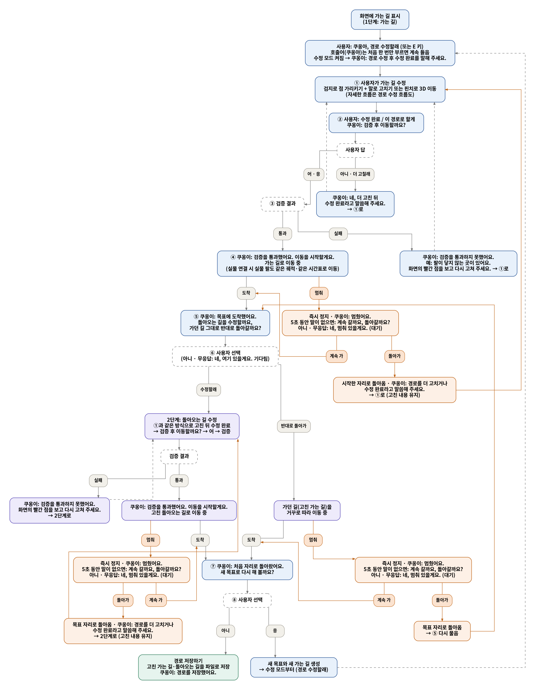

# KHU AI Challenge 2026 — 말과 손으로 로봇팔 경로 고치기 (ChatKHU)

카메라 화면 위에 로봇팔이 갈 경로가 그려집니다. 사용자는 **말("쿠옹아, 경로 수정할래")과 손(엄지·검지로 집어 3D로 끌기)** 으로 경로를 고칩니다. "수정 완료" → "검증 후 이동할까요?" → "어"라고 답하면 MuJoCo 시뮬레이터가 경로를 12항목으로 검증합니다. 통과하면 **실물 6축 팔이 시뮬이 검증한 그 궤적을 같은 시간표로** 따라갑니다.

- 2026-10-28 실물에서 시나리오 한 바퀴를 확인했습니다: 가는 길 → 목표 도착 → 돌아오는 길 → HOME, 5번 이동 모두 완료. 끝 오차는 최대 0.06°, 시뮬 궤적 대비 추종은 최대 2.3°(한계 3°)였습니다.
- 이 저장소 하나에 시연에 필요한 코드, 환경 고정 파일, 모델, **지금 시연 배치의 현장 보정값**이 모두 들어 있습니다. 아래 순서를 따르면 다른 컴퓨터에서도 같은 상태가 됩니다.

## 작업 규칙

- ChatKHU 키는 2026-10-28 저장소 주인 결정으로 `voice/chatkhu_key.env`에 들어 있습니다. **저장소를 공개로 바꾸지 않습니다.** 키가 새면 재발급하고 그 파일을 바꿉니다(이전 키는 git 이력에 남습니다).
- 개인정보, 녹음·대화 기록은 올리지 않습니다.
- 현장 배치(카메라·표지·로봇)를 바꾸면 다시 보정하고, 바뀐 보정 파일을 함께 커밋합니다.
- 각자 브랜치에서 작업하고, 합칠 때는 Pull Request를 올립니다. 브랜치 이름은 무엇을 만들었는지 알 수 있게 짓습니다.

---

## 준비물

| 무엇 | 지금 시연에서 쓴 것 |
|---|---|
| 컴퓨터 | Ubuntu 24.04, Python 3.12.3, OpenGL 그래픽 (확인: RTX 5060 노트북, Wayland). ROS 2가 깔려 있어도 됩니다(`env.sh`가 경로를 분리) |
| 로봇팔 | ROBOTIS XM430-W210-T ×6 (ID n = 관절 n, 각 관절 16:1 감속), U2D2(1 Mbps, `/dev/serial/by-id/usb-FTDI_..._FTB8HROZ-if00-port0`), 12 V 전원과 **손이 닿는 스위치** |
| 로봇 받침 | 180 × 180 × 20 mm 판. 판 가운데가 J1 축입니다. 시뮬은 테이블면을 z = 0으로 씁니다 |
| 카메라 | Orbbec Astra Pro, **거꾸로 달아서**(`rotate_180`) 작업 영역을 0.6 m 넘게 떨어져 내려다봄 |
| 정합 확인 표지 | ArUco 4x4 **5번, 50 mm** 하나. 중심은 로봇 기준 (−0.130, 0.055) m, 책상면 (`pac_vision/config/markers.yaml`) |
| 음성 | 마이크·스피커(노트북 내장으로 확인). ChatKHU 키는 저장소에 있음(`voice/chatkhu_key.env`) |
| 브라우저 | Google Chrome (웹 모니터를 앱 창으로 띄움, 없으면 Firefox) |

다른 U2D2를 쓰면 `manipulator_control_ws/config/robot.yaml`의 `bus.port`를 `ls /dev/serial/by-id/`에 나온 이름으로 바꿉니다. 이 프로그램은 다른 장치를 자동으로 고르지 않습니다.

## 폴더 구성

| 폴더 | 내용 |
|---|---|
| `mujoco_sim/` | 시뮬레이터 `pinch_sim`. 경로 생성·수정·12항목 검증·실행, 웹 모니터(`web/`, Figma "아이로봇" 디자인), 손 입력, 실물 연결(`real_arm.py`, `arm_link.py`) |
| `manipulator_control_ws/` | 실물 팔 제어 `manipulator_control`. 보정, HOME, 시뮬 궤적 재검사·스트리밍(`pinch`). 상세: [README](manipulator_control_ws/README.md), [CURRENT_STATE](manipulator_control_ws/CURRENT_STATE.md) |
| `voice/` | 쿠옹이(ChatKHU Gemini Live). 지시문 `prompts/system_v7.md`, 함수, 호출어, 시뮬 연결 |
| `pac_vision/` | Astra 보정(카메라 → 로봇 기준), 깊이 읽기, 표지 확인. `config/`에 지금 배치의 현장 값 |
| `6dof_description/` | 로봇팔·그리퍼 모델(URDF/MJCF, 메시) |
| `path 편집/` | 경로 편집 알고리즘(시뮬레이터가 그대로 씀) |
| `docs/` | [설치·보정·문제 해결 전체](docs/PINCH_KHU_SETUP.md), 계획서, 흐름 그림 |
| `setup.sh`, `run_demo.sh` | 한 번에 설치, 시연 실행 |

## 처음 한 번: 설치

```bash
git clone https://github.com/jaemin0319/26_project_manipulator.git    # 비공개: gh auth login 먼저. --depth 쓰지 않기
cd 26_project_manipulator
./setup.sh --system     # apt 패키지, Astra udev, dialout·plugdev 그룹, Chrome (sudo, 컴퓨터마다 한 번)
                        # 그룹이 새로 들어갔으면 로그아웃 후 다시 로그인
./setup.sh              # 가상환경 3개(lock 파일의 정확한 버전) + Astra 드라이버(고정 커밋) + 전체 시험 (약 5분)
```

`setup.sh`가 끝에 보여 주는 시험 결과: 실물 제어 152, 시뮬레이터 174(실물 연결 e2e 포함), pac_vision 131, 경로 편집 110, 음성 16 — 모두 passed여야 합니다. 하드웨어 없이 돌아가는 시험입니다.

## 처음 한 번: 현장

1. **배치를 지금과 같게 놓습니다.** 로봇 판, 카메라 자세, 5번 표지 위치가 같으면 저장소의 보정값을 그대로 씁니다. 시뮬은 시작할 때 표지로 정합을 다시 확인합니다. 웹 화면 오른쪽 위 배지와 시뮬 창 출력에 `camera calibration verified ... 최대 7 px / 9 mm` 같은 줄이 나오면 됩니다.
   - 어긋나거나 배치를 바꿨으면 [설치 문서 6절](docs/PINCH_KHU_SETUP.md)대로 다시 보정합니다(A4 ArUco 판으로 `calibrate.py`, 그다음 `check_markers.py`).
2. **로봇 보정:** `./run_demo.sh calibrate`. 3D 창의 기준 자세에 관절을 하나씩 맞춥니다.
   - 서보 보정은 컴퓨터의 `manipulator_control_ws/runtime/`에 저장됩니다(git 제외).
   - **12 V를 껐다 켜면 다시 해야 합니다.** 토크만 끈 것은 괜찮습니다.

## 실행

```bash
./run_demo.sh check     # 실물은 궤적을 검사만 하고 움직이지 않음 (처음엔 이것부터)
./run_demo.sh real      # 실물 이동
```

창이 이 순서로 뜹니다.

1. **실물 제어** 창: HOME 미리보기 → **y** → HOME 도착 → "시뮬 연결 대기"
2. **시뮬** 창과 웹 모니터: 연결 대기가 되면 스크립트가 자동으로 띄웁니다.
3. **음성** 창: 쿠옹이가 연결됩니다.
4. 실물 제어 창에 "시뮬 연결됨 … y = 무장"이 뜨면 팔 주변을 확인하고 **y**를 누릅니다. 이제부터 승인할 때마다 실물이 움직입니다. **12 V 스위치에 손을 둡니다.**

시연:

- "쿠옹아, 경로 수정할래" 또는 화면의 **수정** 단계(E 키)를 씁니다.
- 손: 검지로 0.4초 가리키면 점을 고르고, 엄지·검지로 집어 끌면 3D로 1:1 이동합니다. 마우스 끌기도 됩니다.
- "이전으로"로 되돌립니다.
- **"수정 완료"** → "검증 후 이동할까요?" → **"어"**(또는 화면의 **검증 후 이동**) → 검증 통과 → 실물이 이동합니다.
- 도착하면 "돌아오는 길을 수정할까요, 가던 길 그대로 반대로 돌아갈까요?"라고 묻습니다.

멈춤: "멈춰", 화면 ■, 시뮬 X 키, 실물 제어 창 **s**/스페이스, 12 V 스위치.

끝낼 때:

1. 실물 제어 창에서 **q**를 누릅니다. 토크는 유지됩니다. **창을 닫지 마세요**: 닫으면 종료 기록이 남지 않습니다.
2. 웹 모니터 창을 닫으면 시뮬이 끝납니다.
3. 음성 창은 Ctrl+C로 끕니다.

토크 끄기: `./run_demo.sh torque-off` → **y** → READY → 팔을 손으로 받치고 **x** → **y** → **q**. 보정은 그대로 남습니다.

실물 없이 하기:

- `./run_demo.sh rehearse`: 실물 프로필로 카메라 영상 위에서 연습합니다. 시뮬만 움직입니다.
- `./run_demo.sh sim`: 카메라 없이 시뮬 화면과 마우스로 합니다.
- 음성 키가 없으면 `--no-voice`를 붙이고 화면 버튼과 키보드를 씁니다.

각 창에서 직접 실행하는 명령, 보정, 좌표계, 정지 수단별 동작은 [docs/PINCH_KHU_SETUP.md](docs/PINCH_KHU_SETUP.md)(7절, 7-1절)에 있습니다.

## 대화 흐름

수정 모드를 켜고 가는 길을 고친 뒤 "수정 완료"로 검증하고, 통과하면 바로 목표까지 갑니다. 도착하면 돌아오는 길을 고칠지, 그대로 거꾸로 돌아올지 고릅니다. 움직이는 중에는 언제든 "멈춰"로 멈추고, 계속 갈지 돌아갈지 고를 수 있습니다.



경로 수정 흐름: [docs/flow/flow2_edit.png](docs/flow/flow2_edit.png), 멈춘 뒤: [docs/flow/flow3_stop.png](docs/flow/flow3_stop.png)

## 좌표 한 줄 요약

- **보정 좌표계(base_ref):** 원점은 로봇 베이스 중심(J1 축)이고, +Y는 베이스에서 종이 가운데 쪽, 책상면이 z = 0입니다(m).
- **로봇 위치:** `pac_vision/config/robot_pose.yaml`에 있습니다. 실물은 모델 −Y 쪽에서 일하므로 yaw −90°입니다.
- **MuJoCo world:** 테이블면이 z = 0이고, 로봇은 판 두께 20 mm만큼 올라가 있습니다.
- **실물 제어:** 로봇 기준(판 윗면 z = 0)을 씁니다.

## 문제 해결 (자주 본 것)

- **검증·이동을 안 받음, "실물 로봇팔이 아직 무장 전이에요":** 실물 제어 창에서 무장(y)을 하지 않은 상태입니다. 검증 실패가 아닙니다.
- **검사 전용(`check`)에서 시뮬이 "중단됨"이 되고 "계속 갈까요?"라고 물음:** 정상입니다. 실물이 움직이지 않으니 시뮬이 멈춘 것으로 처리합니다.
- **3D 창(MuJoCo)을 닫았더니 실물 제어 프로그램이 끝남:** 그 창을 닫으면 종료하도록 되어 있습니다. 토크 끄기는 3D 창이 없는 `torque-off` 모드를 씁니다.
- **12 V 전원 LED가 깜빡이고 일부 ID가 안 보임:** 케이블이나 커넥터 단락입니다(10/28에는 ID 3 → 4 케이블이었습니다). `python -m manipulator_control scan`으로 보이는 ID를 확인합니다.
- **손 깊이가 자주 끊김(`no_depth`):** Astra는 0.6 m보다 가까우면 깊이가 없습니다. 카메라를 작업 영역에서 더 멀리 둡니다.
- **`시뮬레이터 소켓이 없습니다`:** 시뮬이 `--voice-gateway`로 먼저 떠 있어야 합니다(`run_demo.sh`는 순서를 지킵니다).
- 그 밖: [docs/PINCH_KHU_SETUP.md 10절](docs/PINCH_KHU_SETUP.md).
