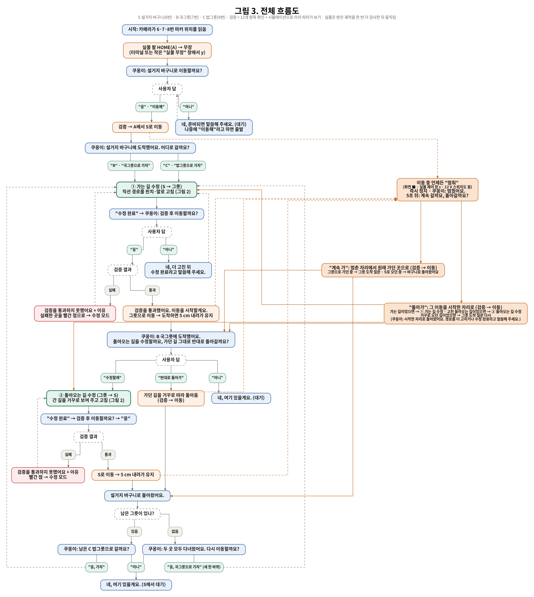
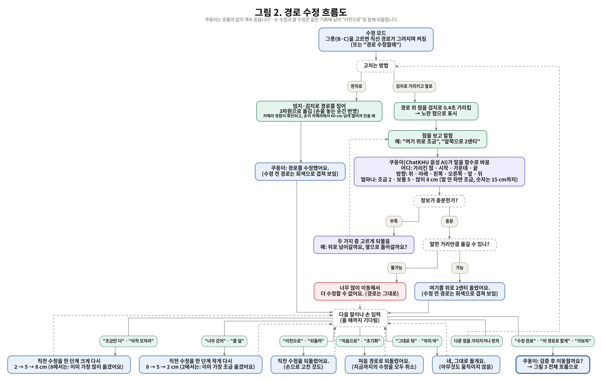

# 말과 손으로 고치는 로봇팔 경로 — 쿠옹이 (ChatKHU)

**팀 아이로봇** · KHU AI Challenge 2026

카메라 화면 위에 그려진 로봇팔의 길을 사용자가 말과 손짓으로 고치면, AI 도우미 **쿠옹이**가 알아듣고 길을 바꿉니다. 안전 검사를 통과하고 사용자가 승인한 길로만 실제 로봇팔이 움직입니다.

시연 영상: [시연 영상 링크]

## 해결하려는 문제

가정에서는 식탁 위 그릇의 배치도, 사람이 바라는 움직임도 매번 다릅니다. 그래서 로봇팔이 지나갈 길(경로)을 자주 고쳐야 합니다. 그런데 지금까지는 좌표 숫자를 넣거나 전용 프로그램을 다뤄야 해서 전문가만 고칠 수 있었습니다. 우리는 "여기 조금 앞으로"처럼 말하거나 손가락으로 길을 집어 옮기는, 사람에게 익숙한 방식으로 누구나 길을 고칠 수 있게 했습니다.

## 사용 장면

식탁 위에 실제 그릇 대신 **ArUco 마커**(카메라가 위치를 읽는 흑백 사각 표식)를 놓아 **설거지 바구니(S)**, **국그릇(B)**, **밥그릇(C)** 자리를 정했습니다. 로봇팔은 바구니와 각 그릇 사이를 오가고, 사용자는 가는 길과 오는 길, 모두 네 경로를 고칠 수 있습니다. 쿠옹이는 부르는 말(호출어) 없이 듣기 때문에, 묻는 말에 바로 답하면 됩니다.

2026-10-29 실물 시연의 대화 기록 중 일부입니다.

> **쿠옹이:** 설거지 바구니로 돌아왔어요. 남은 C 밥그릇으로 갈까요?
> **사용자:** 이동하자.
> **쿠옹이:** C 밥그릇까지 직선 경로를 그렸어요. 경로 수정 후 수정 완료를 말해 주세요.
> **사용자:** 거기 좀만 앞으로 가 봐. → **쿠옹이:** 여기를 앞쪽으로 2센티 옮겼어요.
> **사용자:** 거기 조금만 더. → **쿠옹이:** 여기를 앞쪽으로 5센티 옮겼어요.
> **사용자:** 됐어. 이제 가보자. → **쿠옹이:** 검증 후 이동할까요? → **사용자:** 이동하자.

손으로도 고칩니다. 검지로 경로 위 점을 잠깐(0.4초) 가리키면 그 점이 골라지고, 엄지와 검지로 길을 집으면(핀치) 손이 움직인 만큼 3차원으로 옮겨집니다. 화면의 대화창에는 쿠옹이가 물을 때 고를 수 있는 답(예: "B 국그릇", "C 밥그릇")이 버튼으로 뜨고, 대화창을 접으면 지금 할 수 있는 말("국그릇으로 가자" 등)을 추천해 보여 줍니다. 화면 오른쪽 아래의 작은 3차원 화면은 마우스로 끌어 돌려 볼 수 있습니다.

[화면 캡처]

## 흐름도

전체 흐름: 바구니로 이동 → 그릇 고르기 → 가는 길 수정 → 검증·승인 → 이동 → 돌아오는 길 수정 또는 그대로 돌아오기 → 남은 그릇

경로 수정 흐름: 핀치로 고치기, 또는 검지로 가리키고 말로 고치기

시연 배치도는 [docs/figures/fig1_layout.png](docs/figures/fig1_layout.png), 시스템 구성도는 [docs/figures/fig5_system.png](docs/figures/fig5_system.png)에 있습니다.

## AI가 하는 일과 안전 장치

**AI가 하는 일**
- **쿠옹이(경희대 ChatKHU의 실시간 음성 모델):** 사용자의 말을 이해해 16가지 기능(경로 옮기기, 되돌리기, 그릇 고르기, 이동 승인 등) 중 알맞은 것을 고릅니다. 어디를·어느 쪽으로·얼마나 옮길지 모자라면 두 가지 중 고르게 되묻고, 한 일을 짧게 설명합니다.
- **손 인식(MediaPipe):** 카메라 영상에서 손가락 위치를 찾습니다. 깊이 카메라로 손의 3차원 위치를 잽니다.

**안전 장치.** AI는 로봇을 직접 움직이지 않습니다. 실제 이동은 아래를 모두 거친 뒤에만 일어납니다.
1. **12개 항목 검증:** 팔이 닿는지, 관절이 꺾일 수 있는 범위인지, 특이점(팔이 너무 펴지거나 꺾여 위험한 자세)에 가깝지 않은지, 책상이나 로봇 자신과 부딪히지 않는지, 속도와 모터 힘이 충분한지 등을 확인하고, 시뮬레이션으로 미리 따라가 봅니다.
2. **사용자 승인:** 쿠옹이가 "검증 후 이동할까요?"라고 묻고, 사용자가 그렇다고 해야 움직입니다.
3. **로봇 쪽 재검사:** 로봇을 움직이는 프로그램이 받은 길을 한 번 더 검사합니다.
4. **무장 확인:** 실물 팔은 처음에 사람이 한 번 확인(y 키)해야 명령을 받습니다.

"하지 마", "그대로 둬" 같은 말에는 움직이지 않고, 뜻이 불확실하면 움직이기 전에 묻도록 쿠옹이에게 지시했습니다. 이동 중에는 "멈춰"(음성), 화면의 정지 버튼, 실물 제어 창의 s 키, 12 V 전원 스위치로 멈출 수 있게 만들었습니다.

## 실제로 확인한 것

| 항목 | 결과 (실행 기록·자동 시험 기준) |
|---|---|
| 지점 시연 한 바퀴 (2026-10-29, 실물) | 출발 자세 → 바구니 → 국그릇(가는 길 수정) → 바구니 → 밥그릇(가는 길 수정) → 바구니(오는 길 수정). 실물 이동 5번 모두 완료, 검증 5번 모두 12개 항목 통과 |
| 2026-10-29 하루 전체 | 실물 이동 32번 모두 완료, 시뮬 검증 35번 통과·실패 0번(연습 실행 포함), 실물이 시뮬레이션 궤적을 따라간 오차 최대 2.43° (허용 3°) |
| 자동 시험 | 시뮬레이터 179개, 실물 제어 153개, 카메라·보정 131개, 경로 편집 110개, 음성 16개 모두 통과 |

## 폴더 구성

- `voice/` — 쿠옹이 음성 프로그램 (ChatKHU 연결, AI 지시문, 기능 16개)
- `mujoco_sim/` — MuJoCo 시뮬레이터, 경로 수정·12개 항목 검증, 웹 화면, 손 입력, 실물 연결
- `manipulator_control_ws/` — 실물 로봇팔 제어 (보정, 받은 길 재검사, 같은 시간표로 이동)
- `pac_vision/` — 깊이 카메라 보정, 마커 읽기, 현장 설정값
- `path 편집/` — 경로를 부드럽게 휘게 하는 편집 알고리즘
- `6dof_description/` — 6축 로봇팔과 그리퍼 모델
- `docs/` — 그림(`docs/figures/`), 설치·실행 안내

## 설치와 실행

설치, 보정, 실행 방법은 [docs/SETUP.md](docs/SETUP.md)에 있습니다.
