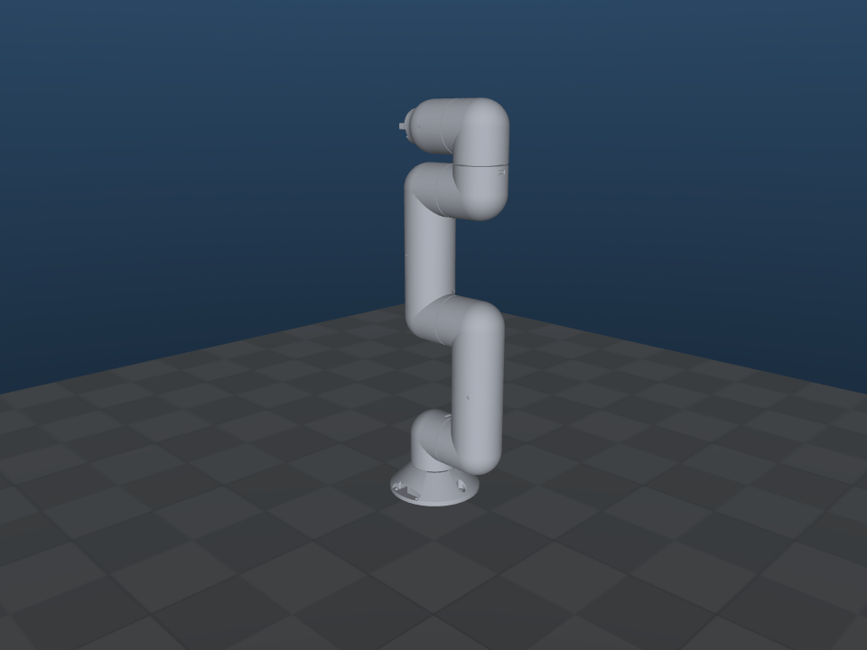
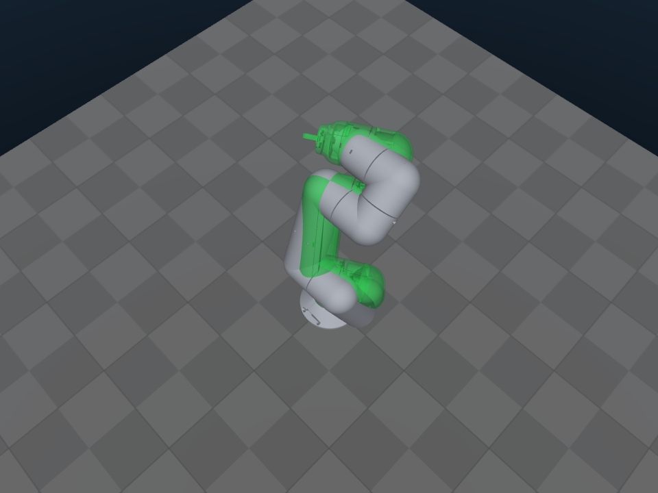
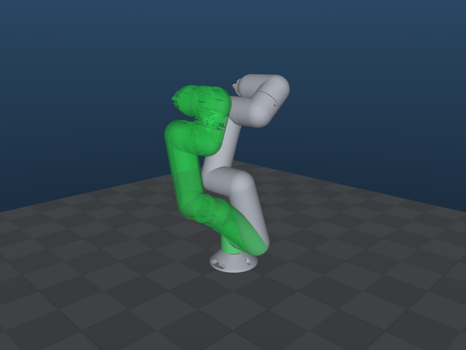
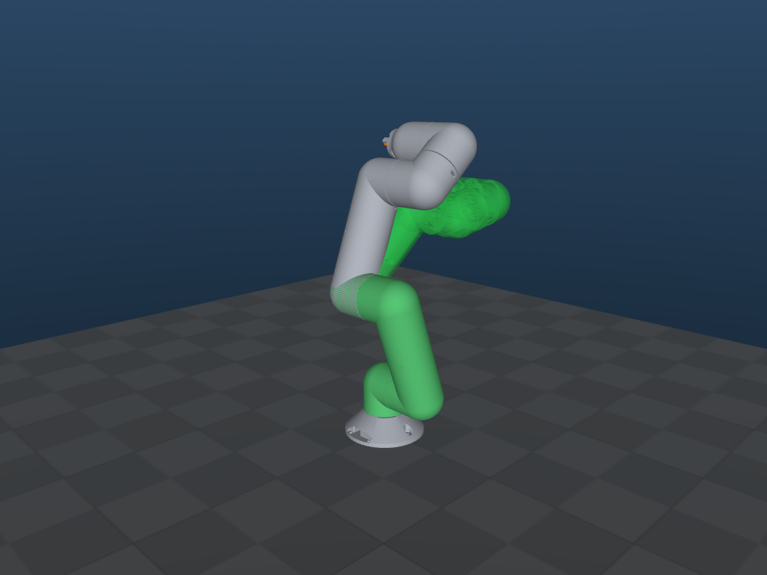
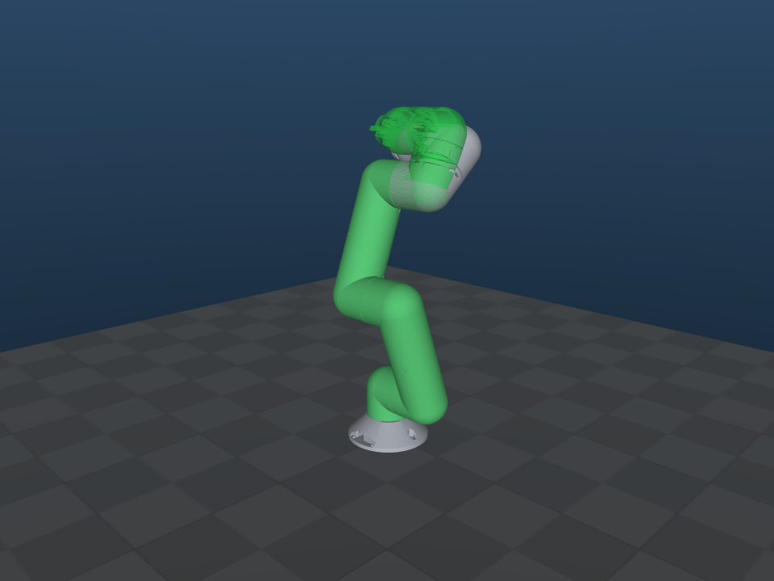
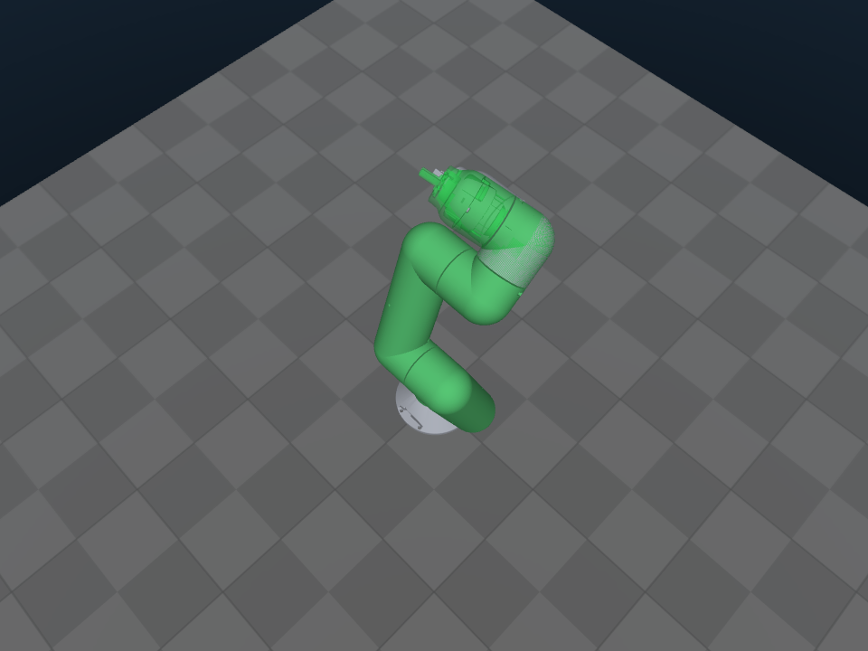
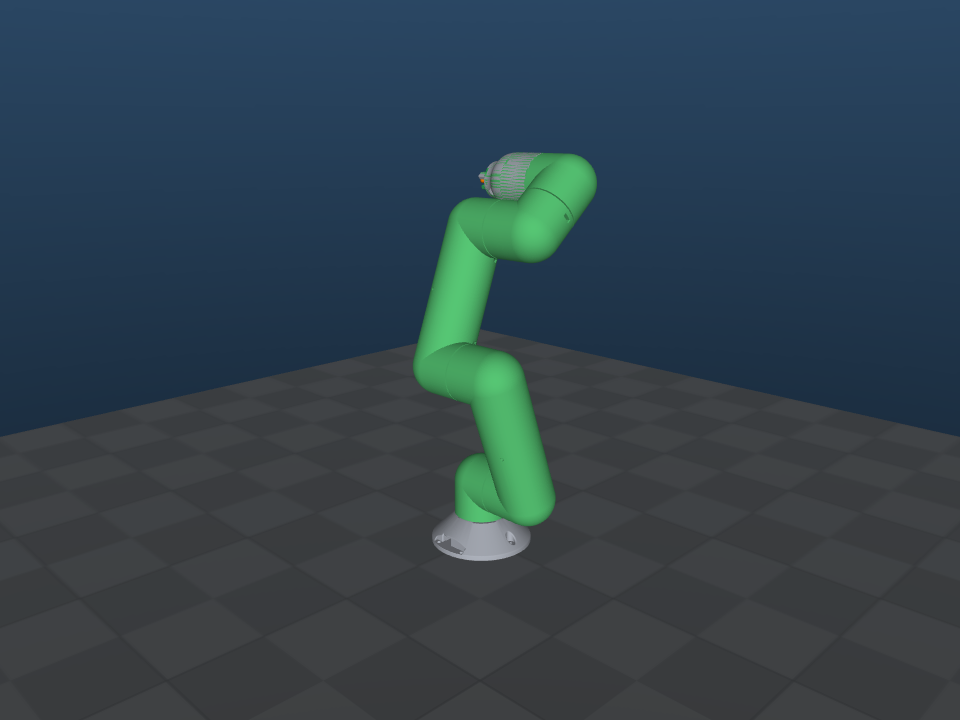

# 보정 안내서: 부호 s · 기준 자세 q_ref · 가동 범위 · HOME 확정

이 문서는 `config/robot.yaml`의 `null` 값을 실물에서 정하는 순서예요.

- 값이 하나라도 `null`이면 `prepare`(토크 ON·이동)는 포트를 열기 전에 거부해요.
- `scan`과 `watch`는 읽기 전용이라 `null`이 있어도 실행돼요.
- 아래의 모든 측정은 **토크 OFF**에서 해요. 토크 OFF 상태에서는 팔이 자중으로 처지므로, 손이나 지그로 받치고 천천히 움직여요.

준비:

```bash
cd ~/manipulator_control_ws && source scripts/env.sh
# DYNAMIXEL Wizard를 닫는다 (포트를 잡고 있으면 scan/watch가 열지 않고 멈춘다). 12 V 전원 ON.
python -m manipulator_control scan          # ID·설정 확인. 모터에 쓰지 않는다 (마지막 줄 "모터 쓰기 0회")
```

`scan`에서 `prepare 거부 사유`(Drive Mode bit2/bit3, Startup Configuration, Bus Watchdog, HW Error 등)가 나오면, 그 값을 직접 확인한 뒤에 진행해요. 이 프로그램은 그 값들을 바꾸지 않아요.

---

## 0. 현재 방식: `calibrate` (2026-10-26 사용자 결정)

- 기준 자세는 **팔을 위로 곧게 뻗은 자세**에서 **관절 3 = −90°(케이블 길이), 관절 5 = +90°**예요(`q_ref_deg` = [0, 0, −90, 0, 90, 0]). 그림: `img/ref_pose.png`.
- 확인된 부호(2026-10-26 17:18, 사용자가 눈으로 다시 확인): 6개 모두 +1.
- `python -m manipulator_control calibrate`를 실행하면 관절 1부터 6까지 하나씩 진행해요.
  1. 부호가 미확정인 관절은 먼저 방향을 확인해요. SIM의 초록 팔이 + 방향으로 흔들리면, 실물을 그쪽으로 조금 돌린 뒤 y를 눌러요. 각도는 몰라도 돼요.
  2. 그 관절을 SIM 기준 자세에 맞추고 Enter를 누르면, 그 관절 원점이 등록되고 그 자리에서 토크 ON으로 고정돼요.
- 아래 관절부터 차례로 고정되므로 팔 전체를 계속 받칠 필요가 줄어요.
- 감속비는 방향 확인 때 노란 링크가 실물과 비슷한 크기로 따라 도는지 보고 확인해요.
- 2절(watch로 부호 확인)과 3절(기준 자세 정하기)은 이 방식 이전의 방법이에요. 기준 자세를 바꿀 때 참고해요.
- **결과는 저장돼요(최근 것 하나만):**
  - 6개 관절이 모두 고정되면 `runtime/calibration_state.json`에 P_ref, 관절 설정, 서보 설정, 마지막으로 보낸 PA/PV를 저장해요.
  - 다음 calibrate를 시작하면 이 파일을 먼저 지워요.
  - prepare / teleop은 정렬 없이 이 보정을 써요. 단, 서보의 PA/PV 읽기값이 저장된 값과 정확히 같을 때만이에요(아래 7절). 실행 중 통신이 끊기면 보정을 지워서 다시 calibrate하게 해요.
  - `robot.yaml`의 부호·기준각·감속비·ID를 바꾸면 저장된 보정은 맞지 않으므로, calibrate를 다시 해야 해요.

---

## 1. URDF 영점과 + 방향 (하드웨어 없이 SIM에서 확인)

관절각은 **URDF 규약**을 따라요. 각 관절의 각도는 부모 링크에 대한 자식 링크의 상대 회전이고, + 방향은 URDF에 적힌 축에 대한 오른손 법칙이에요.

```bash
python -m manipulator_control pose                    # 모든 관절 0
python -m manipulator_control pose --sweep 3          # 관절 3을 +30°까지 반복: + 방향 확인
python -m manipulator_control pose --q-deg 0,30,60,0,0,0
```

| 모든 관절 0 (팔이 위로 곧게 섬) | 관절별 + 방향 (회색: 자세 B = [0, 20, 40, −30, 0, 0]°, 초록: 그 관절만 +30°) |
|---|---|
|  | J1  J2  J3  J4  J5  J6  |

| 관절 | 부모 → 자식 | 축 (URDF) | q = 0의 의미 (모델 기준) | + 방향 (모든 관절이 0일 때) |
|---|---|---|---|---|
| Revolute_1 | base_link → r_a_1 | +z | 어깨 피치축(R2)이 베이스의 X축과 평행 | 위에서 내려다볼 때 반시계 |
| Revolute_2 | r_a_1 → link_1 | +x | 위팔(link_1)이 수직으로 곧게 섬 | 위팔이 −Y 쪽으로 기움 |
| Revolute_3 | link_1 → link__1__1 | **−x** | 아래팔이 위팔과 일직선 | R2와 반대 방향 (아래팔이 +Y 쪽으로) |
| Revolute_4 | link__1__1 → r_a__1__1 | +x | 손목 링크가 아래팔과 일직선 | R2와 같은 방향 (−Y 쪽으로) |
| Revolute_5 | r_a__1__1 → r_a__2__1 | +z | 손목 롤 영점: R6 축이 R4 축과 평행 (q = 0에서 둘 다 X 방향) | 위에서 내려다볼 때 반시계 |
| Revolute_6 | r_a__2__1 → housing_1 | **−x** | 그리퍼 롤 영점: 그리퍼 방향이 SIM의 q = 0 그림과 같음 (툴 축은 R6 축과 평행) | 툴 축(−X)을 따라 오른손 법칙 |

- 곧게 선 자세라도 롤 관절(R1, R5, R6)의 영점은 따로 정의돼 있어요. 실물에서는 **SIM의 q = 0 그림과 같은 방향**이 되도록, 부모·자식 링크의 면이나 구멍 같은 특징을 비교해서 정해요.
- "위팔이 −Y 쪽"은 모델 좌표계 기준이에요. 실물에서 어느 쪽이 앞인지는 이 작업공간에서 정의하지 않았어요. 실물과 화면을 같은 방향에서 보고 맞춰요.

## 2. 부호 s와 감속비 확인 (`watch`, 읽기 전용)

```bash
python -m manipulator_control watch
```

- 보정 전에는 SIM의 팔이 하늘색 "UNCALIBRATED"로 표시돼요. 이 자세는 실제 자세가 **아니에요**.
- 터미널에는 시작 위치 대비 관절별 **상대 변화[deg]**가 나와요. 이 값은 부호 s = +1을 가정해서 계산한 것이에요.
- Enter를 누르면 상대 변화의 0점을 지금 위치로 다시 잡아요.

관절마다 아래 순서로 확인해요.

1. 다른 관절은 받친 채로 두고, 그 관절 하나만 1절의 **+ 방향**으로 천천히 돌려요.
2. 그 관절의 상대 변화가 **증가하면 s = +1**, **감소하면 s = −1**이에요.
3. 부모 링크 기준으로 각도기나 직각자를 대고 약 90° 돌렸을 때 상대 변화가 약 ±90°이면 감속비 16:1이 맞아요.
   - 서보 축 기준으로는 16384 count예요.
   - ±5.6°나 ±1440° 근처가 나오면 감속비 설정이 틀린 거예요.
4. 표시된 관절 번호와 실제로 돌린 관절이 다르면 ID 대응이 틀린 거예요.

## 3. 기준 자세 각도 q_ref 정하기

q_ref는 마킹을 맞췄을 때의 **관절각(URDF 규약)**이에요.

- **링크가 세계 기준으로 기운 각도는 관절각이 아니에요.** URDF 축은 관절의 로컬 좌표계에 있고, 앞 관절의 자세에 따라 세계 기준 방향이 바뀌어요.
- 예를 들어 아래팔의 수직 대비 기울기에는 R2와 R3가 함께 들어 있어요. 스마트폰 경사계로 잰 링크 하나의 기울기를 그대로 q_ref에 넣지 않아요.
- 세계 기울기가 관절각과 같은 경우는, 베이스가 수평일 때 위팔(link_1)의 수직 대비 기울기 = |q2|뿐이에요. 이마저도 확인용으로만 써요.

### 3.1 권장: URDF 각도가 명확한 자세로 마킹 정의

- 가능하면 **0° 또는 직각(±90°)**의 조합 중 실물로 정렬하기 쉬운 자세를 고르고, 그 자세에서 마킹을 다시 그어요.
- 예: R2 = R3 = R4 = 0(팔이 곧게 섬, 자중 모멘트가 작음)이면, 위팔·아래팔·손목이 일직선인지 직선자로 확인할 수 있어요.
- R1, R5, R6은 1절의 롤 영점 정의에 따라, 부모·자식 링크의 특징이 SIM의 q = 0 그림과 같아지도록 맞춰요.
- 직각 자세를 쓸 때는 부모 링크에 직각자를 대고 자식 링크를 90°로 맞춰요. 세계 수직이나 수평에 맞추지 않아요.

### 3.2 기존 마킹을 유지할 때

관절마다 마킹을 맞춘 상태에서, **부모 링크에 대한 자식 링크의 상대 각도**를 그 관절의 영점(1절 표의 "q = 0의 의미")과 비교해서 재요.

- **R2, R3, R4:** 부모 링크 중심선과 자식 링크 중심선 사이의 각도를 재요. 영점에서는 일직선이에요. 부호는 1절의 + 방향 그림을 따라요.
- **R1, R5, R6 (롤):** 축 둘레로, 부모의 기준 특징(면·구멍)과 자식의 기준 특징 사이의 각도를 재요. 영점은 SIM q = 0 그림과 같은 방향이에요.
- 각도기, 지그, 기구의 기준면을 써요. 추가 센서는 필요 없어요.

### 3.3 확인 (읽기 전용)

1. 2절에서 정한 s와 3.1/3.2에서 정한 q_ref를 `robot.yaml`에 적어요. `limit_deg`는 아직 `null`이어도 돼요.
2. `watch`를 실행하고, 마킹에 맞춘 상태에서 Enter를 눌러요. 쓰기 없이 기준만 등록돼요. 이후 SIM의 회색 팔이 실제 계산 각도로 그려져요.
3. 실물과 SIM을 **같은 방향**에서 보고 자세를 비교해요(사진을 찍어 두면 좋아요).
4. 관절 하나를 기하학적으로 확실한 자세로 옮겨서 SIM 표시와 비교해요. 예: 부모 링크 기준 직각자 90°이면 SIM이 90° ± 1°여야 해요. 다르면 q_ref나 s를 고쳐요.
5. 같은 마킹으로 3회 다시 정렬하고 Enter를 눌러서, 판정 통과 여부와 정지 잡음(로그의 `spread_counts`)을 기록해요.

## 4. 실물 가동 범위 limit_deg

1. s와 q_ref를 확정한 상태에서 `watch`를 실행하고, 마킹에서 Enter를 눌러 읽기 전용 보정을 해요.
2. 관절마다 받친 채 천천히 양 끝까지 돌리면서 다음을 확인하고, 그때의 각도를 기록해요.
   - 기구 간섭
   - 케이블 길이·꼬임 (특히 R1, R5, R6)
   - 책상·주변 물체
3. 기록한 끝 각도에서 **여유 5° 이상**을 빼서 `limit_deg: [lo, hi]`로 적어요.

## 5. HOME 확정

1. **HOME 후보 확인:**
   - 후보는 시뮬 ready = [0, 36.743, 75.193, −51.550, −90.000, −8.008]°예요.
   - 각 값이 4절의 범위 안에 있는지 확인해요.
   - HOME 자세는 `python -m manipulator_control pose --q-deg 0,36.743,75.193,-51.55,-90,-8.008`로 SIM에서 볼 수 있어요. `watch`의 초록 고스트는 HOME이 아니라 기준 자세예요.
   - `watch`를 보정한 상태(마킹에서 Enter)에서, 받친 채 손으로 팔을 HOME 근처까지 옮겨 보세요. 터미널의 `q[deg]`가 HOME 값에 가까워지는지, 실물 주변(책상·케이블)과 부딪히지 않는지 확인해요.
   - 안전하면 `home.confirmed: true`로 바꿔요.
2. **경로 확인:**
   ```bash
   python -m manipulator_control preview-home          # 기준 자세 -> HOME, prepare와 같은 정수 PV/PA 계획을 재생
   ```
   - 출력에서 다음을 확인해요: 예상 시간, 축별 PV/PA, 도착 시각 차, 공동 궤적 편차(2° 초과 시 경고), TCP 경로 차, 거부 사유.
   - 모델 경로 검사는 자기충돌과 장착면만 봐요. 책상·케이블·사람은 직접 확인해요.
   - 실물 경로가 안전하다고 확인한 경우에만 `home.path_confirmed: true`로 바꿔요.
3. **유지 시험** `prepare --hold-only`를 해요(손은 계속 받친 상태).
   - Enter → 기준 등록 → 현재 자세 유지로 토크 ON → HOLDING 순서예요.
   - 점프 ≤ 0.5°, 잔여 ≤ 0.2°, SIM과 실물 자세가 일치해야 하고, 3회 반복해요.
4. **HOME** `prepare`(관절 속도 상한 22.5 °/s, 가속 5 °/s² 상한, 처음엔 `--home-speed-deg-s 2.5`로 낮출 수 있음)를 해요.
   - 한 손은 **12 V 전원 스위치**에 둬요.
   - 정지는 터미널에서 s/space예요. 통신이 살아 있을 때만 동작해요.
   - 이상이 없으면 `--home-speed-deg-s 5`, 그다음 11.25 순서로 속도를 올려요.

## 6. 기록표 (측정한 사람·날짜를 함께 적는다)

| 관절 | s (2절) | 90° 회전 시 상대 변화 | q_ref [°] (3절) | 측정 방법·기준 특징 | 실측 끝 각도 [°] | limit_deg [°] (여유 반영) | HOME [°] | 비고 |
|---|---|---|---|---|---|---|---|---|
| Revolute_1 | | | | | | | 0.000 | |
| Revolute_2 | | | | | | | 36.743 | |
| Revolute_3 | | | | | | | 75.193 | |
| Revolute_4 | | | | | | | −51.550 | |
| Revolute_5 | | | | | | | −90.000 | |
| Revolute_6 | | | | | | | −8.008 | |

- 기준 자세 설명과 마킹 위치(`reference.note`):
- HOME 실물 확인(`home.confirmed`) — 확인한 사람/날짜:
- 경로 확인(`home.path_confirmed`) — 확인한 사람/날짜, 확인 방법:
- 정렬 반복 3회의 판정과 `spread_counts`:

## 7. 반복 정렬과 정확도에 대해

- 전원을 다시 켜거나 서보가 재부팅되면 다회전 카운트가 1회전 안으로 초기화돼요. 그러면 저장된 P_ref는 맞지 않아요.
  - 재부팅하면 PV/PA가 0이 되고 토크가 꺼져요. 이 프로그램은 PV/PA에 0을 쓰지 않으므로, prepare / teleop이 시작할 때 이를 감지하고 거부해요(저장된 보정도 지워요).
  - 그 뒤에는 calibrate를 다시 해요.
- 전원이 계속 켜져 있는 동안은 토크를 꺼도(x → y) 카운트가 이어지므로 보정이 유지돼요.
  - 다음 prepare / teleop이 토크가 꺼진 관절을 그 자리에서 다시 고정(y)해요.
- 토크가 꺼져 있는 동안 서보는 Goal을 현재 위치와 같게 유지하고(2026-10-26 22:59 실측: 6축 모두 Goal − Present = 0), 토크를 켤 때도 그 순간의 위치로 잡아요(매뉴얼에는 없음). 그래서 Goal은 근거로 쓰지 않고 PA/PV만 비교해요. 토크 ON 전 Goal 확인도 보낸 값 ±36 count 안이면 통과해요.
- 실행 중 통신이 끊기면(COMM_LOST) 저장된 보정을 지워요(사용자 규칙). 다시 calibrate해야 해요.
- 마킹 정렬 오차는 그대로 관절 영점 오차가 돼요. 감속기 백래시도 엔코더(감속기 앞)로는 보이지 않아요.
- READY 판정(엔코더 기준 0.2°)은 "서보가 목표에 도착했다"만 뜻해요. 관절의 실제 각도 오차는 외부 기준(2차 마킹, 직각자)으로 따로 확인해요.
- 재현성 목표: 전원 재인가 5회 후 HOME에서 관절별 ±0.5° 이내(초기 기준, 실측으로 조정)예요.
